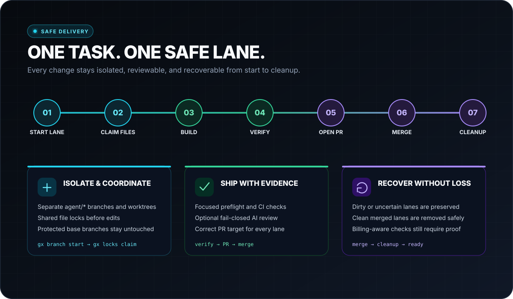

<p align="center">
  
</p>

# GitGuardex

**Run Codex, Claude, and human contributors in parallel without sharing a checkout.** GitGuardex adds file claims, PR review gates, and safe cleanup to Git worktrees. One task → one worktree → one PR.

[](https://www.npmjs.com/package/@imdeadpool/guardex)
[](https://github.com/opencue/gitguardex/actions/workflows/ci.yml)
[License](./LICENSE)

[Quick start](#quick-start) · [AI code review](#code-assist-review-gate) · [Impact Assist](#impact-assist) · [How it compares](#how-it-compares)

## Quick start

Requires Node.js 18+, Git, and an authenticated GitHub CLI (`gh`) for the PR flow. Use Linux or macOS; on Windows, use WSL.

```sh
npm install -g @imdeadpool/guardex
cd /path/to/repo
gx setup
gx branch start "Add checkout validation" "codex" --no-transfer
```

Enter the worktree printed by `gx branch start`. Claim the files you intend to edit:

```sh
gx locks claim --branch "$(git branch --show-current)" src/checkout.ts
```

Make the change and run your project's tests. Then ship the PR:

```sh
gx branch finish --via-pr --wait-for-merge --cleanup
```

Finish can commit and open the PR, run the selected gates, then squash-merge and clean up the finished lane. It does not override GitHub branch protection.

## Code-assist review gate

For AI code review, install and authenticate the Codex or Claude Code CLI.

```sh
gx pr-review --pr 123 --post
```

Review an existing PR using your local Codex CLI. GitGuardex falls back to Claude Code if Codex cannot launch; pin either with `--provider`. The review posts severity, file and line, and the reason a finding matters. **Posting a review does not merge the PR.**

With `--gate-review`, high and critical findings block the finish. Add `--gate-autofix` to attempt fixes and review the new head before merging. A green CI run is not a substitute for a clean review, or vice versa.

```sh
gx branch finish --via-pr --wait-for-merge --cleanup --gate-review --gate-autofix
```

<details>
<summary>See a real review on GitHub</summary>


[Open the example PR](https://github.com/projects-kssk/Wireless_KFB_Project/pull/165) · [Full-size screenshot](https://raw.githubusercontent.com/recodeee/gitguardex/main/docs/images/code-assist-review-gate.png)

</details>

---

## Impact Assist

**Code review asks what could break. Impact Assist asks what the repository gains or gives up by merging.** The review renders this as a **PR impact** section: benefits, trade-offs, links to supporting diff lines, and suggested next steps when available.

For example, a material benefit (**+25**) and a notable trade-off (**−10**) yield **65/100** from a neutral baseline of **50**. That is a diff-based estimate, not a benchmark or a merge verdict. If the diff is incomplete or the estimate has no valid supporting evidence, the section reports it as unavailable.

[See Impact Assist on a real GitGuardex PR](https://github.com/opencue/gitguardex/pull/897#pullrequestreview-6070455129).

## How it compares

| If you use… | It handles… | What GitGuardex adds |
| --- | --- | --- |
| Plain `git worktree` | Separate checkouts | Task identity, shared file claims, and cleanup that preserves work it cannot safely remove |
| A standalone AI reviewer | Findings on a diff | Optional blocking review and autofix tied to the PR finish, plus a separate impact estimate |
| GitHub Actions and branch protection | Required checks and merge rules | Local preflight, worktree ownership, and a single workflow from task start to cleanup |

GitGuardex works with Git, GitHub, and your existing agent CLI. It does not replace them.

<details>
<summary>See the problem and capability diagrams</summary>

## The problem


### What GitGuardex can do

<p align="center">
  
</p>

</details>

## More workflows

- **See what other agents own:** `gx status`, `gx context path/to/file`, or the [agent cockpit](./docs/agents-cockpit.md).
- **Preview cleanup and storage:** `gx cleanup --dry-run` and the [worktree storage guide](./docs/worktree-storage.md).
- **Configure verification:** [local preflight](./docs/preflight.md), [OpenSpec (opt-in)](./docs/openspec-getting-started.md), or `gx --help`.
- **Advanced worktrees:** [provisioning, navigation, and lifecycle hooks](https://github.com/opencue/gitguardex/blob/f748d7e02c853b29826bb1e1005127468de407e8/README.md#worktree-provisioning) and [VS Code setup](https://github.com/opencue/gitguardex/blob/f748d7e02c853b29826bb1e1005127468de407e8/README.md#see-every-lane-in-vs-code).
- **Launch with a Cue profile:** [preview, start, and resume GitGuardex tasks](https://github.com/opencue/cuecards/blob/main/docs/gitguardex-workflows.md).

<details>
<summary>Agent skills and maintainer releases</summary>

```sh
npx skills add recodee/gitguardex
gx release  # create/update the current GitHub release from README notes
```

`gx setup` does not auto-run `npx skills add ...`. If the picker does not show a separate `guardex` skill, that is expected; use the `gitguardex` skill.

`gx release` is the maintainer path for package releases. It reads `README.md`, finds the last published GitHub release, and writes one grouped GitHub release body.

</details>

[Contributing](./CONTRIBUTING.md) · [Security](./SECURITY.md) · [Issues](https://github.com/opencue/gitguardex/issues) · [Third-party notices](./THIRD-PARTY-NOTICES.md)

GitGuardex is independent and is not affiliated with OpenAI or Anthropic.

## Release notes

<details>
<summary><strong>v8.x</strong></summary>

### v8.4.0
- Added authenticated agent messaging that delivers live when safe and queues
  durably when Nodeterm or tmux delivery is unavailable.
- Added worktree-shared CLI and MCP inbox operations for reading and
  acknowledging queued agent messages.
- Improved stale Codex worktree recovery and VS Code visibility for managed
  worktrees.

### v8.3.0
- Added adaptive direct-main agent work and branch-targeted `gx sync`.
- Made worktree cleanup safer by preserving active or locked lanes while pruning
  only eligible merged or opted-in clean lanes.
- Persisted and validated explicit finish bases, recognized SHA-256 null object
  IDs, and prevented stale VS Code worktree providers.

### v8.2.0
- Reduced agent preflight and finish token overhead.
- Preserved dirty worktrees during stale-worktree cleanup and exposed
  command-specific cleanup help.
- Added the owning tmux pane and worktree to file-lock conflict output.

### v8.1.1
- Prevented `gx doctor` from pruning dirty detached or managed worktrees during
  stale-worktree repair.

### v8.1.0
- Added shared Git lock state so independent clones coordinate file ownership.
- Aligned npm repository metadata with `opencue/gitguardex` for trusted OIDC
  publishing.

### v8.0.0
- Added `gx branch finish --fast` for small tasks that should use the PR +
  squash-merge path without repeating local preflight or opt-in AI review.
- Removed the legacy `cr.yml` AI-review workflow; repository policy and explicit
  Guardex review gates now control merge readiness.

</details>

<details>
<summary><strong>v7.x</strong></summary>

### v7.1.1
- Bumped `@imdeadpool/guardex` from `7.1.0` to `7.1.1` so the current
  `main` payload can publish under a fresh npm version after `7.1.0` reached
  the registry.
- Direct maintainer `npm publish` now checks npm during `prepublishOnly` and
  bumps package release metadata to the next unpublished patch version when the
  committed version is already published. GitHub Actions release publishes keep
  the committed metadata so packed and signed assets stay aligned.

</details>
